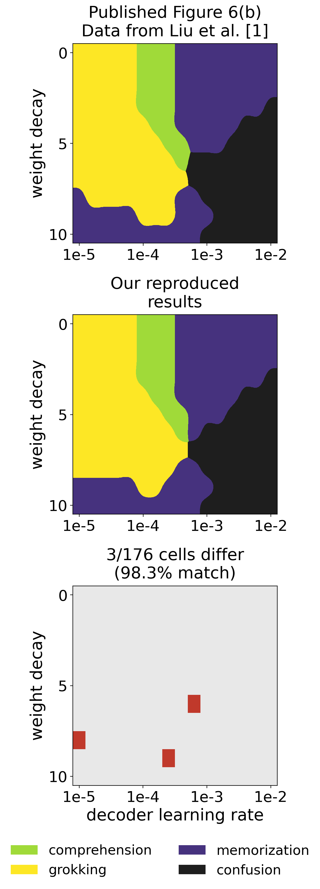

# Figure 6(b) reproduction

This folder contains our reproduction of the addition/regression phase diagram
in [Liu et al. (2022), Towards Understanding Grokking](https://arxiv.org/abs/2205.10343).
We trained all 176 settings for 100,000 steps each. Our classifications match
the published results in **173 of 176 runs (98.3%)**.



## Files

- `run_fig6b.py` runs the experiment.
- `notebook_source.py` loads and adapts the training function from the authors' notebook.
- `plot_fig6b.py` plots the saved results.
- `compare_to_paper.py` makes the three-panel comparison used in the report.
- `verify_results.py` checks the saved data without retraining.
- `verify_source.py` compares training with and without the RQI calculation.
- `check_discrepancies.py` repeats the extra checks described in the report.
- `results/fig6b/` contains all 176 completed runs, their settings, and accuracy curves.
- `figures/` contains the plots and tables. Use `fig6b_comparison_stacked.pdf` in the report.
- `checks/` contains the saved measurements from the additional checks.
- `reference/published_fig6b_panel.png` is the original panel extracted from the paper.

New training runs and regenerated plots go into `runs/`, which Git ignores.
The submitted data in `results/` are kept separate.

## Code and settings

We adapted cells 0 and 1 of
[`phase_diagram_plot/phase_diagram.ipynb`](../phase_diagram_plot/phase_diagram.ipynb)
from [the authors' repository](https://github.com/ejmichaud/grokking-squared),
commit `0229df94de69b8384e560367280a43a238112bf5`.
Their notebook and data are already included in this group repository.
The authors' credit and [MIT licence](../LICENSE) are retained.

We kept the model, initialization, training updates, and accuracy calculation.
Our code adds parallel runs, logging, and result saving. It skips unused SciPy
imports and the RQI calculation, which only measures the embedding structure.
The extra checks restore that calculation and compare the results.
Unused random draws in the original initialization are kept because removing
them changes later random values, even with the same seed.

| Setting | Value |
| --- | --- |
| Task | Addition of integers from 0 to 9 |
| Data | 55 unordered pairs, split into 45 training and 10 validation pairs |
| Embeddings | One trainable scalar per integer |
| Decoder | Sum of the two embeddings, then layers 1 → 200 → 200 → 30, with tanh hidden layers |
| Targets | One fixed random vector of 30 numbers for each of the 19 possible sums |
| Loss and accuracy | Mean squared error, with the closest target vector giving the predicted sum |
| Decoder learning rates | 16 values from `10**np.linspace(-5, -2, 16)` |
| Decoder weight decays | Integers from 0 to 10 |
| Embedding optimizer | AdamW, learning rate 0.001, weight decay 0 |
| Decoder optimizer | AdamW, using the grid settings |
| Training | Full batch, 100,000 steps per run, seed 58 |
| Execution | CPU, eight worker processes, one PyTorch thread per run |

The grid comes from the authors' `phase_diagram_plot/data_add_r.h5` file.
Their saved results recreate all 194,010 pixels of the published panel.
That check identifies the reference data. The 98.3% result above compares our
own training runs with those data.

We initially used `toy/train_add.py` and a ten-column grid. Checks showed that
these did not reproduce the published setup. The submitted results use the
notebook training function and the correct 16-column grid.

Each run is classified using the first step at which accuracy reaches 90%.
If both training and validation reach 90%, a delay of more than 1,000 steps
means grokking. A delay of 1,000 steps or less means comprehension.
If only training reaches 90% within 100,000 steps, the label is memorization.
If neither reaches 90%, the label is confusion. Step numbers start at zero.
The saved value `99999` means the threshold was not reached. The records also
store `reached_train` and `reached_test` to distinguish a crossing at the last
step, although no submitted run has that case.

## Setup

Use Python 3.10 on Linux or WSL. The saved runs used Python 3.10.22 on an Intel
Core Ultra 5 228V CPU. The pinned PyTorch build includes CUDA support, but these
scripts run on CPU and do not require a GPU. The training runner uses `fcntl`,
so it does not run in native Windows Python.

From the repository root:

```bash
cd fig6b_reproduction
python3.10 -m venv .venv
source .venv/bin/activate
python -m pip install -r requirements.txt
```

Use a separate environment for this folder so the pinned versions do not
change another group member's setup. The versions used for the completed runs
are also recorded in `checks/environment.json`.

Run all commands below from `fig6b_reproduction/` with this environment active.

## Check the results and remake the figures

These commands use the saved runs and do not train the model again:

```bash
python verify_results.py
python plot_fig6b.py
python compare_to_paper.py --ours runs/figures/fig6b_phase_data.npz
```

The check should report 176 records, 352 crossing-time files, 176 accuracy
curve files, and 173 matching classifications. The comparison also checks that
the authors' data recreate the published panel exactly.

The new plots are saved in `runs/figures/`. The comparison PDF is
`runs/figures/fig6b_comparison_stacked.pdf`.

## Run training again

A short test runs one setting for 100 steps:

```bash
python run_fig6b.py --steps 100 --workers 1 --limit 1 --outdir runs/quick_test
```

The complete experiment runs 176 × 100,000 training steps:

```bash
python run_fig6b.py --steps 100000 --workers 8 --seed 58 --curve-every 100
python verify_results.py --resdir runs/fig6b
python plot_fig6b.py --resdir runs/fig6b
python compare_to_paper.py --ours runs/figures/fig6b_phase_data.npz
```

Repeating the training command resumes runs that have not finished. Use a new
output directory if you change the settings, environment, or training script.
The curve files save accuracy every 100 steps and at the final step. The code
checks for the first 90% crossing at every step.

## Differences and extra checks

| Decoder learning rate | Weight decay | Liu et al. | Our result |
| ---: | ---: | --- | --- |
| 0.000630957344480193 | 6 | Confusion | Memorization |
| 0.00001 | 8 | Memorization | Grokking |
| 0.0002511886431509582 | 9 | Grokking | Memorization |

For weight decay 6, training accuracy ended at 84.4%. A 5,000-step repeat with
accuracy recorded every step found 39 measurements above 90%. Validation never
reached 90% in the full run, so memorization follows the authors' rule.
This explains our label, but not why Liu et al. reported confusion.

For weight decay 8, repeating the full run with two CPU threads moved the first
validation crossing from step 76,884 to 76,849. It was still classified as
grokking. Restoring the RQI calculation with one thread gave the same crossing
times and saved curves as our original run.

To repeat these checks:

```bash
python verify_source.py
python check_discrepancies.py brief-crossing
python check_discrepancies.py threads --threads 2
python check_discrepancies.py threads --threads 1 --rqi
```

The last two commands each train one model for 100,000 steps. New measurements
go into `runs/`. The original measurements are in `checks/`.

We could not establish the cause of the three differences. The authors'
PyTorch and NumPy versions were not identified. Software or hardware could
affect numerical results, but these checks do not show that either caused
the classification differences. We used only seed 58.

## Changes made for submission

We shortened comments and changed file paths so the scripts work in the group
repository. New outputs go into `runs/` instead of the submitted results folder.
The saved training results and their original metadata are unchanged. Their
script hashes describe the versions used for the completed experiment, before
these packaging changes. `verify_results.py` checks the data and notebook
hashes, without claiming that the edited scripts have the old file hashes.

The publication check and saved-data checks are separate from retraining.
Matching saved data does not guarantee identical new training results on
another computer.
